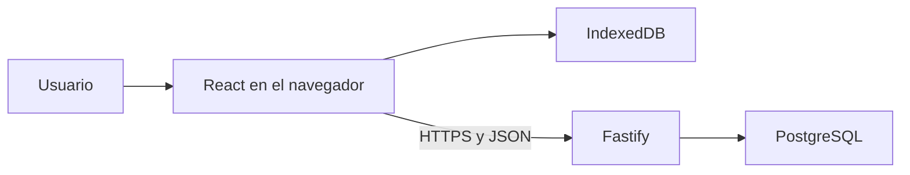

# Guía del proyecto
Guía breve para entender `field-service-pwa`: qué problema resuelve, dónde vive cada pieza y cómo viaja un reporte desde el teléfono hasta PostgreSQL.
Un **PWA** (aplicación web progresiva) es un sitio que el navegador puede instalar y volver a abrir, con recursos guardados en el propio dispositivo. Una **API REST** es un conjunto de direcciones HTTP que envían y reciben datos en JSON.
## 1. ¿Qué es este proyecto?
Los técnicos de campo anotan reportes de servicio donde la red falla. Si el formulario solo existe en línea, el reporte se pierde al cortarse la conexión.
La aplicación permite:
- Crear una cuenta e iniciar sesión.
- Escribir un reporte con descripción y coordenadas.
- Guardarlo en el dispositivo aunque no haya red.
- Enviarlo a la API cuando la conexión vuelve.
- Consultar los reportes ya confirmados de esa cuenta y verlos en un mapa.
El objetivo es una PWA usable en el navegador de Android e iOS, no una aplicación de tienda. El servidor confirma los reportes en PostgreSQL.
## 2. Tecnologías utilizadas
| Tecnología | Para qué sirve | Dónde está |
| --- | --- | --- |
| React 19 y TypeScript | Interfaz y tipos | `apps/web` |
| Vite 8 | Servidor de desarrollo y build del frontend | `apps/web/vite.config.ts` |
| Tailwind CSS 4 | Estilos con clases en el HTML | `apps/web/src/styles/index.css` |
| Dexie 4 | Acceso a IndexedDB, la base local del navegador | `apps/web/src/features/reports/db.ts` |
| Leaflet 1.9 | Mapa con teselas de OpenStreetMap | `apps/web/src/features/reports/ReportMap.tsx` |
| vite-plugin-pwa y Workbox 7 | Manifiesto de instalación y Service Worker | `apps/web/vite.config.ts`, `apps/web/src/pwa/` |
| Fastify 5 | Servidor HTTP | `apps/api` |
| Zod 4 | Validar entradas y respuestas | `packages/validation` |
| Drizzle ORM y `pg` | Esquema y consultas a PostgreSQL | `apps/api/src/db/` |
| pnpm 12 y Turborepo | Monorepo: varios paquetes en un solo repositorio | `pnpm-workspace.yaml`, `turbo.json` |
| Vitest | Pruebas | `apps/api/tests/`, `apps/web/src/**/*.test.ts` |
| GitHub Actions | Flujo de calidad escrito, no observado en ejecución | `.github/workflows/ci.yml` |
| Render | Despliegue público con HTTPS | `render.yaml`, `docs/deployment/render.md` |
No hay React Router, Docker ni proyectos Android o iOS. `apps/mobile` solo reserva un lugar futuro para Capacitor.
## 3. Estructura de carpetas y archivos
| Ruta | Responsabilidad |
| --- | --- |
| `apps/web` | Interfaz. No abre PostgreSQL ni importa `apps/api`. |
| `apps/api` | HTTP, cuentas, reportes y, en producción, los archivos de la web. |
| `apps/mobile` | Reserva. No hay proyecto nativo. |
| `packages/contracts` | Tipos compartidos de las respuestas. |
| `packages/validation` | Esquemas Zod de esas respuestas y de los cuerpos de entrada. |
| `packages/domain` | Reservado. No contiene reglas de negocio. |
| `packages/config` | Reservado. La configuración real está en cada app. |
| `database/migrations` | SQL versionado. La API no lo aplica al arrancar. |
| `docs/` | Requisitos, ADR, pruebas y despliegue. |
| `render.yaml` | Blueprint de un servicio. No se aplicó como blueprint. |
| `.env.example` | Nombres de variables, con `USER` y `PASSWORD` de ejemplo. |
## 4. ¿Cómo funciona la aplicación?
No hay páginas con rutas propias. `App` elige una sección (`inicio`, `reportes`, `mapa`, `sincronizacion`, `ajustes`) y la pinta dentro de la misma pantalla.
1. El navegador abre `apps/web/index.html`, que carga `apps/web/src/main.tsx`.
2. En un build de producción, el cliente registra el Service Worker. En `pnpm dev` ese registro no hace nada.
3. `App` lee la cuenta guardada en IndexedDB. Si no hay, muestra el alta o el acceso.
4. Con sesión, `HomeScreen` muestra las secciones. Un reporte nuevo se escribe primero en IndexedDB.
5. Si hay red y sesión, la cola hace `POST /api/v1/reports`. La API valida el cuerpo, comprueba la cookie y guarda la fila en PostgreSQL.
6. Al haber red, la web también baja con `GET /api/v1/reports` los reportes ya confirmados de esa cuenta.
En desarrollo hay dos procesos: Vite en `http://127.0.0.1:5173` reenvía `/health` y `/api` a Fastify en el puerto 3000. En producción un solo proceso Node sirve la interfaz y la API en el mismo origen. El navegador llama rutas relativas (`/health`, `/api/...`).

La copia local es provisional. El reporte queda confirmado cuando el servidor responde 201 o 200.
## 5. Frontend
| Archivo | Qué hace |
| --- | --- |
| `apps/web/src/main.tsx` | Arranca React y pide el registro del Service Worker. |
| `apps/web/src/app/App.tsx` | Sesión local, sonda de la API y cambio entre acceso y pantalla principal. |
| `apps/web/src/app/api-status.ts` | `GET /health` y `GET /health/ready`. La base de la URL es `VITE_API_URL`, vacía en este proyecto. |
| `apps/web/src/components/home/HomeScreen.tsx` | Navegación y las cinco secciones. |
| `apps/web/src/features/auth/AuthScreen.tsx` | Formulario de cuenta. |
| `apps/web/src/features/auth/session.ts` | Alta, acceso y salida contra `/api/v1/auth/*`. |
| `apps/web/src/features/reports/ReportsScreen.tsx` | Formulario y lista. |
| `apps/web/src/features/reports/use-field-reports.ts` | Estado de la lista y disparo de la cola. |
| `apps/web/src/features/reports/ReportMap.tsx` | Puntos sobre teselas de OpenStreetMap. |
| `apps/web/src/styles/index.css` | Activa Tailwind. Los estilos viven en las clases de cada componente. |
`credentials: "include"` hace que el navegador envíe la cookie de sesión. El frontend no guarda la contraseña ni el token.
## 6. Backend y API
El proceso entra por `apps/api/src/server.ts`. Lee el entorno, abre PostgreSQL solo si existe `DATABASE_URL` y llama a `buildApp`. En producción exige que exista `apps/web/dist/index.html`.
Desarrollo, desde la raíz:
```bash
pnpm --filter @field-service/api dev
```
Eso ejecuta `tsx watch src/server.ts`. El script no carga `.env`.
| Método y ruta | Función | Archivo |
| --- | --- | --- |
| `GET /health` | La API está viva. No consulta la base. | `apps/api/src/routes/system.ts` |
| `GET /health/ready` | 200 si PostgreSQL responde; 503 si no está configurada o caída. | El mismo |
| `GET /api/v1` | Identifica el servicio y la versión. | El mismo |
| `POST /api/v1/auth/register` | Crea la cuenta y la cookie. | `apps/api/src/routes/auth.ts` |
| `POST /api/v1/auth/login` | Comprueba la contraseña y crea la cookie. | El mismo |
| `POST /api/v1/auth/logout` | Borra la cookie. | El mismo |
| `GET /api/v1/auth/me` | Perfil de la sesión. | El mismo |
| `GET /api/v1/reports` | Reportes confirmados de esa cuenta. | `apps/api/src/routes/reports.ts` |
| `POST /api/v1/reports` | Alta idempotente: el mismo `clientId` y el mismo cuerpo no duplican la fila. | El mismo |
| `GET /api/v1/reports/:clientId` | Un reporte de esa cuenta. | El mismo |
Zod, en `packages/validation/src/index.ts`, revisa el cuerpo antes de usarlo. Si falla, la API responde 400. Sin cookie válida, 401. El mismo identificador con otro contenido, 409. Sin base configurada, 503.
Los errores hacia el cliente salen de `toErrorBody` en `apps/api/src/shared/http-errors.ts`. El cuerpo tiene `error.code` y `error.message`. No incluye la traza ni la cadena de conexión. La contraseña se guarda con scrypt. La sesión viaja en la cookie `fs_session`, HttpOnly y SameSite=Lax.
## 7. Base de datos
La conexión se crea en `apps/api/src/db/client.ts` con un pool de `pg` y Drizzle. El esquema TypeScript está en `apps/api/src/db/schema.ts`. Las consultas de cuentas y reportes están en `apps/api/src/auth/repository.ts` y `apps/api/src/reports/repository.ts`.
| Tabla | Para qué sirve |
| --- | --- |
| `infrastructure_checks` | Fila técnica de comprobación. No es un reporte. |
| `users` | Nombre, correo y hash de la contraseña. |
| `sessions` | Hash del token de sesión y su caducidad. |
| `service_reports` | Reporte confirmado: `client_id` único, descripción, cuenta y coordenadas opcionales. |
Migraciones:
- `database/migrations/0000_create_infrastructure_checks.sql`
- `database/migrations/0001_create_service_reports.sql`
- `database/migrations/0002_add_accounts_and_coordinates.sql`
`pnpm --filter @field-service/api db:migrate` solo acepta dos destinos de desarrollo identificados: la base `field_service_dev` en local, o la base `appweb_ykvs` en su host ya comprobado. Cualquier otro destino se rechaza. La API no migra al arrancar.
No copies `DATABASE_URL` a la guía ni al repositorio. El ejemplo está en `.env.example`.
## 8. Funcionamiento PWA y modo sin conexión
| Pieza | Dónde |
| --- | --- |
| Manifiesto | `apps/web/public/manifest.webmanifest`, enlazado en `apps/web/index.html` |
| Iconos | `apps/web/public/icons/` (PNG de 192 y 512, normales y maskable) |
| Plan de caché | `apps/web/src/pwa/workbox-options.ts` |
| Registro | `apps/web/src/pwa/register-service-worker.ts` |
| Service Worker generado | `sw.js`, solo después de `pnpm build`. No está escrito a mano. |
El Service Worker precachea el shell: HTML, JS, CSS, favicon, manifiesto e iconos. Si una navegación no es `/api` ni `/health`, responde con `index.html`. No guarda las respuestas de la API.
IndexedDB, base `field-service`, guarda los reportes y el perfil visible de la cuenta. No guarda la contraseña.
| Sin internet, después de haber abierto el sitio una vez | Necesita conexión |
| --- | --- |
| Abrir la interfaz ya visitada | Primera visita y alta o acceso |
| Ver y crear reportes locales | Enviar la cola y bajar los confirmados |
| Perfil guardado en el dispositivo | Teselas del mapa, que salen de OpenStreetMap |
| | Sincronizar con la página cerrada |
La cola corre con la aplicación abierta: al entrar, al volver la red, al hacerse visible la página, con un temporizador y con el botón de reintento. No usa Background Sync. Esa API no está en el código. En iOS no hay una prueba de sincronización registrada.
La instalación en un teléfono quedó anotada como confirmación verbal el 29 oct 2026. No hay captura en el repositorio. Las pruebas escritas de Chrome para Android y Safari para iOS siguen pendientes.
## 9. Comandos útiles
Todos se ejecutan en la raíz del repositorio, con pnpm 12.15.0. Node no carga `.env` por sí solo: las variables tienen que estar ya en el entorno.
| Comando | Qué hace |
| --- | --- |
| `pnpm install` | Instala las dependencias del monorepo. |
| `pnpm --filter @field-service/web dev` | Vite en `http://127.0.0.1:5173`. No registra el Service Worker. |
| `pnpm --filter @field-service/api dev` | API en `http://127.0.0.1:3000`. |
| `pnpm typecheck` | TypeScript de todos los paquetes. |
| `pnpm lint` | ESLint. |
| `pnpm format:check` | Comprueba Prettier sin reescribir. |
| `pnpm test` | Vitest de la API y de la web. |
| `pnpm e2e` | Flujo en Edge. Solo si Edge está instalado en las rutas de Windows del script y hay base de desarrollo. |
| `pnpm build` | Compila paquetes, web y API. La web comprueba el manifiesto y `sw.js`. |
| `pnpm start` | `node apps/api/dist/server.js`. Para servir también la interfaz hace falta `NODE_ENV=production` y el build previo. |
| `pnpm --filter @field-service/api db:generate` | Genera SQL desde el esquema. |
| `pnpm --filter @field-service/api db:migrate` | Aplica migraciones solo a un destino de desarrollo permitido. |
`pnpm --filter @field-service/web test` y `pnpm --filter @field-service/api test` ejecutan un solo paquete.
